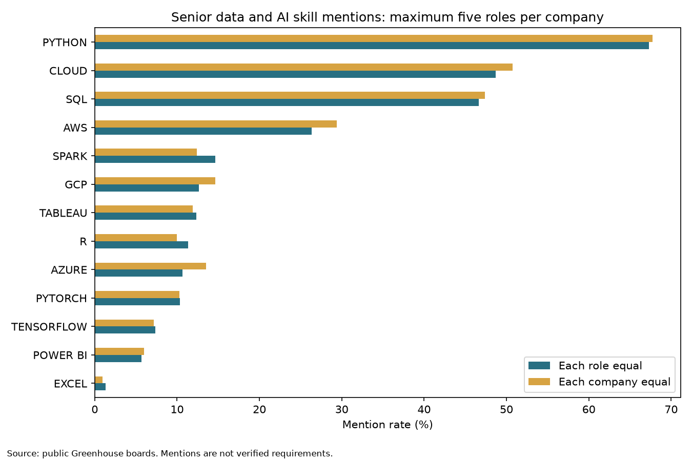
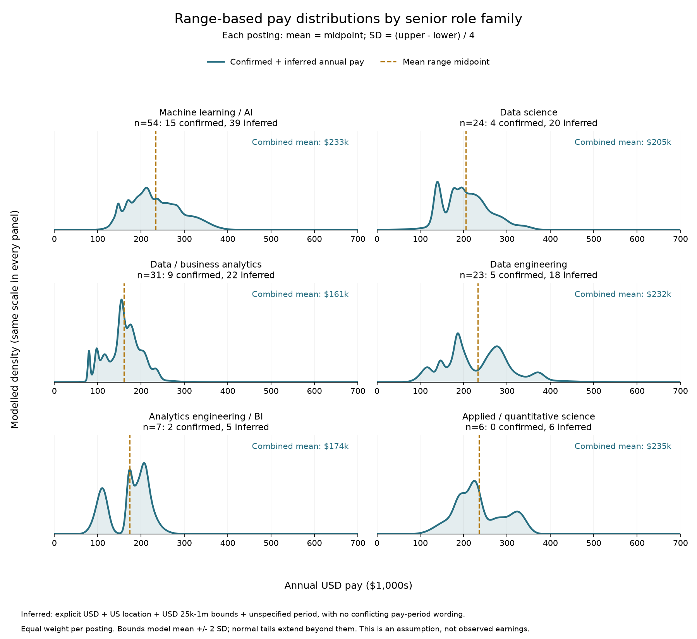

## Which technical skills are connected with senior level data positions?

As a "Statistics: Data Science" student at BYU, I want to connect the tools I learn with possible career paths. Browsing many openings from one large company gives a bit of a narrow impression of skills I need to have to apply. This prompted me to ask myself: which technical skills appear in senior AI, machine learning, data science, and analytics roles across most employers, and is their a connection between these skills and higher paying positions? This blog will explore the salaries and necessary skills of Data Scientists, Machine Learning/AI Engineers, and other data-related roles.

## Data Overview and API Details

I decided to scrape the internet and also use the [public Greenhouse Job Board API](https://docs.greenhouse.io/job-board.html), as this source would give me free access to the information needed and wouldn't require a monthly subscription like other services. A [LastRound AI directory](https://github.com/fyrosofttech/lastroundai-hiring-data/tree/main/ats-directory) supplied 4,966 candidate Greenhouse boards across the alphabet - its directory is licensed, and credit also goes to the directory's [salary-transparency study](https://lastroundai.com/blog/salary-transparency-study-2026). I got the historical live job board counts from this [open-ats-feed](https://github.com/veresk06/open-ats-feed). I should mention that I did not get any job description from directories - those came from the available Greenhouse web scrapes. The most historically active job boards were visited first and scraped.

## Breadth of Data Aquisition

The data consists of over 300 job descriptions with over 100 different companies represented in the dataset. I only allowed five samples from each company (including failures and descriptions without pay) as to not inflate the data pool with one company and their requirements.

I first requested its title list without description content to make the search faster, then I removed repeated internal role IDs and selected across role families before adding more from a family, checking for employerIDs and saved IDs as to prevent restarts from replacing unsuccessful selections. After review of my web scraping I found that there were some overlapping roles in companies such as xai, wpp, fanaticscollectibles, and vmlenterprisesolutions. I decided to exclude those later job boards entirely, preserved their requests in the audit history, and blocked future requests there to keep the final sample count below five.

This excerpt shows the basic function for obtaining the json object of the job boards:

``` python
# These IDs were selected and saved before requesting details.
for job_id in cache["planned_ids"]:
    detail_url = (
        f"https://boards-api.greenhouse.io/v1/boards/{board}/jobs/{job_id}"
        "?pay_transparency=true"
    )
    detail = get_json(session, detail_url)
```

The complete workflow is in `project.py` and is much more complex. I wanted to search for senior positions for the sake of avoiding bias, so I searched for key phrases Senior/Sr., Staff, Principal, Lead, Distinguished, or relevant management/leadership wording while explicitly rejecting internship and junior positions. Research-scientist titles also need machine-learning or data-science evidence in their descriptions.

The search inspected 278 boards containing 87,943 metadata entries, and attempted 617 descriptions. Metadata entries are not collected descriptions. Cleaning found 303 qualifying salary-disclosing roles across 102 companies. I retained one role per contributing company first, then filled the count of job listings to 300 with 53 variables and a maximum of 5 roles per company.

## Related careers have different tools

| Role family                    | Retained roles |
|--------------------------------|---------------:|
| Machine learning / AI          |            113 |
| Data engineering               |             57 |
| Data / business analytics      |             54 |
| Data science                   |             50 |
| Applied / quantitative science |             14 |
| Analytics engineering / BI     |             12 |

The related families include data engineering, analytics engineering/BI, business analytics, and applied or quantitative science. Common exact titles include Senior Data Scientist (6 roles, 6 employers); Staff Data Scientist (5 roles, 5 employers); Senior Data Engineer (4 roles, 4 employers).

After decoding HTML, I used explicit text patterns for 13 skills. The following bar chart demonstrates the frequency of mentions of each skill in all of the job postings by percentage. It is split up into two averages - one by keeping all of the role titles constant (without giving a ton of weight to the most frequent role, Mcahine Learning Engineer), and the other keeping the companies constant (to avoid bias of five open roles in one company vs one open role in another).



The most popular technical skills seem to be Python, then cloud computing skills, then SQL. Cloud includes AWS, Azure, GCP, or the word “cloud,” so these indicators overlap and the variable "CLOUD" should be considered as a sum of these associated skills. Averaging within each company and then across companies gives Python 67.7%, SQL 47.4%, and cloud 50.7%. The blue weighs each job posting equally and the gold weighs each company - comparing both summaries helps us understand how repeated roles influence the overall picture, as they are about equal.

## Analysis of Pay Scale by Role

I summarized each posting's annual USD range by a fabricated normal curve, then averaged those distributions within a role family. Forr example, if a role included "Pay Scale: 100k-150k," then I created a normal curve around a mean = 125k. Exact titles each occur once in this subset, so I grouped related titles that had enough data to them:



Teal curves smooth the observed normal distributions using a calculated standard deviation according to the size of the pay range (they do not assume one bell curve) and the orange dashed lines show group averages. The salaries for the majority of these observations were assumed to be annual, although we had to assume this for a lot of postings (the annual pay is explicit for 35 postings and inferred for 110). Therefore, these graphs are for illustrative purposes only.

| Role family | Comparable postings | Mean advertised midpoint, rounded |
|-----------------------|--------------------:|---------------------------:|
| Machine learning / AI | 54 | \$233,000 |
| Data science | 24 | \$205,000 |
| Data / business analytics | 31 | \$161,000 |
| Data engineering | 23 | \$232,000 |
| Analytics engineering / BI | 7 | \$174,000 |
| Applied / quantitative science | 6 | \$235,000 |

In this sample, average midpoints are about \$161,000 for data/business analytics, \$233,000 for AI/ML, and \$232,000 for data engineering. Data science averages \$205,000 across 24 postings. Applied and quantitative science has the highest average at about \$235,000, based on six postings whose annual periods were all inferred. (Location, employer mix, and seniority may contribute to these differences and was not analyzed as a factor. Further analysis of these variables would make this data available for statistical inference).

The salary comparison uses 145 postings from 51 employers that met the annual USD range criteria, but the annual period was only confirmed for 35 postings and inferred for the rest of the 110. When a posting has several qualifying regional ranges, the analysis uses the lowest lower bound and highest upper bound. The published \$17,100–\$253,000 range is included as reported.

## Limits and Conclusion

Some limits and bias may be caused by using greenhouse as a source for data - coverage, historical board activity, salary disclosure, title rules, and the five-role cap from greenhouse all shape this sample. Even though we weighted it equally by company, there's only so much we can do in order to avoid potential biases, and this analysis only officially applies to the data I collected and not the general population of data roles.

My HTML requests are sequential with a three-second pause, timeouts, local caching, and no automatic retries, and access errors or rate limits stopped my data collection occasionally. All data collection and publication is coherent with the API Terms of Use, and I did not violate any of the warnings taught in STAT 386 which include avoiding applicant data and private endpoints.

My practical analysis of the data is that there are many different pay ranges for data related roles in the job market. According to the data scraped in this blog, if you want a concentrated salary \>= 200k and a field with a lot of openings, follow Machine Learning Engineering or Data Science roles, and learn Python and its ML packages, SQL, Cloud software, and visualization software. Data/Business Analytics roles offer less of a variance in salary, but also cap out at a lower pay. Data engineers and Quantitative Scientists can make a lot of money, but these roles are more niche and may be harder to get into. Overall, this is a great field to start in and it has an even better upside in late career roles.

The Python code and instructions are available in the [Data Acquisition project repository](https://github.com/Nacho9771/Data_Aquisition_Lab).